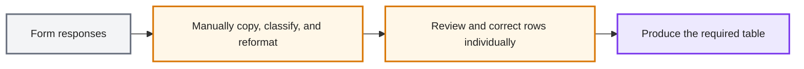
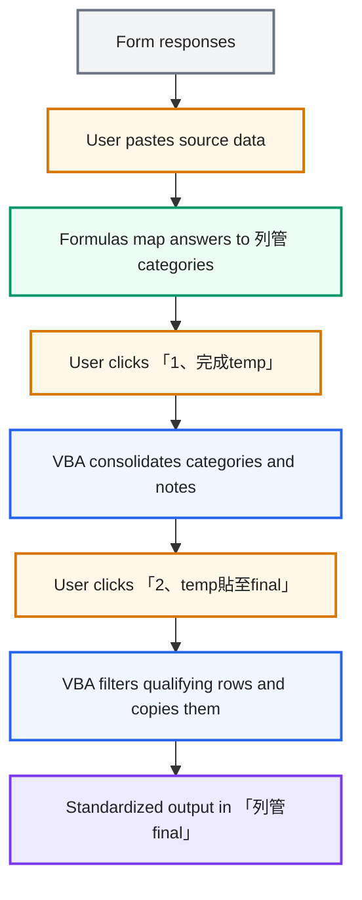

# Air-Gapped Excel/VBA Workflow for 列管 Records

> An Excel tool that transforms form responses into a standardized 列管 record sheet by combining worksheet formulas with button-driven VBA macros.

Created during military service to reduce repetitive data preparation. Users paste form responses into the workbook, run the cleanup steps in sequence, and use the resulting standardized table for follow-up work. The term **列管** is kept in Chinese because it refers to a specific record category in the workbook.

## Built for an offline environment

The workstation had no external network access, so development and testing had to happen locally. I discussed requirements with an AI assistant verbally on a separate phone, but could not transfer workbook data or copy code to the workstation. I manually typed and tested the VBA offline. The project demonstrates adapting an automation idea under constrained conditions—not development in a fully connected AI coding setup.

## Before and after

### As-Is — manual, row-by-row preparation

*Color key: input data = gray · manual work = amber · output = purple.*

### To-Be — formula-assisted mapping and VBA automation

*Color key: input data = gray · user actions = amber · formula mapping = green · VBA processing = blue · final output = purple.*

## User workflow

1. Paste form responses into the source-data sheet.
2. Click 「1、完成temp」 to let VBA consolidate the mapped categories and notes in 「列管temp」.
3. Click 「2、temp貼至final」 to filter and copy qualifying rows into 「列管final」.
4. Use 「清除temp和final產出」 when preparing the workbook for another run.

## Implementation approach

- **Excel formulas** map response fields to the workbook's 列管 categories.
- **VBA macros** consolidate categories and notes, filter qualifying rows, copy the output, and clear temporary results.
- **Worksheet buttons** give users a simple, ordered way to run the multi-step workflow.

The original project notes report an **85% reduction** in formatting and data-cleaning time. The baseline, sample size, and calculation method are not documented in this case study.

## Project files

- [Excel workbook](國軍列管項目.xlsm)
- [VBA source listing](國軍列管項目.txt)

## Portfolio note

The names shown in the sample material are fictional. Before sharing workbook screenshots or data, verify that all remaining values and context are also appropriate for public viewing. The macro source is available in the linked project files.
